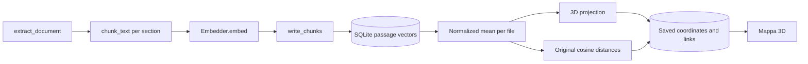

# Esper: a native instrument for recall

Esper is a **Python/Qt Widgets desktop application**. Its widgets call the local
archive, chunker, embedding and search functions directly. There is no browser,
webview, JavaScript runtime, HTTP server or cloud-hosted interface in the app.
The earlier Svelte prototype has been removed.

The visual identity carries over the approved monochrome optical console:

- Natural-language search is the starting activity. Archive browsing is secondary.
- Black, white and grayscale palettes have corresponding dark and light themes.
- Angular frames, fine rules, focus marks, monospace chrome and quiet optical
  rings provide structure; content uses comfortably readable type.
- The recall display draws actual archive images or passages using QPainter.
  Its frame count refers to actual selectable documents. It does not insert demo
  documents or invent measurements. Arrow buttons/keys select a frame; clicking
  it opens the document.
- Main text is approximately 14–17px, with larger search and section headings.
  Source passages wrap and determine card height. The application scrolls
  vertically; it does not shrink text to fit more content.
- Motion can be paused. Qt's platform reduced-motion hint is respected when
  exposed by the installed Qt/platform. Preferences are saved per archive.
- All product copy remains Italian. Keep instructions short and avoid repeated
  slogans, protocol labels or decorative telemetry.

The name comes from the instrument in *Blade Runner*. The user also cited a
Ted Chiang story about recalling images from the past; the exact story title
has not been confirmed.

## Search and the archive map

The three search modes sit beside the query as exclusive buttons. The active
choice has a filled background and updates the open search. The compact recall
viewer leaves space for recent files at the minimum window size. File cards
pair a format glyph with the filename and give the open arrow its own action.

The map is a separate native workspace. Its perspective grid follows the
camera. Marker shapes distinguish formats in both themes. The selected file
has a pinned filename with a leader to its marker, including when multiple
files project to the same point. The keyboard-accessible selector reaches the
entire archive. The reader opens through the same path as a search result.

The archive worker reads a consistent vector snapshot on a cache miss. A
revision check under the write lock prevents publishing a stale projection
after concurrent indexing. For more than 512 documents the principal axes
are fitted on an evenly spaced sample in document-ID order. All documents with
usable vectors are projected. Exact pairwise comparisons run in blocks and
take quadratic time as the archive grows. Four neighbor nominations per file
bound the number of saved edges.

## Implementation boundaries

`esper/desktop/service.py` provides Qt-independent archive operations and owns a
lazily loaded model. `worker.py` serializes model work and mutations on one
QThread; every operation opens its own SQLite connection. The GUI receives Qt
signals and reads short snapshots to display actual document status. Search
requests have generation IDs so old results cannot replace a newer query.

The original-file preview reads the archived file, avoiding duplicated overlap
from concatenating chunks. TXT and Markdown render natively; images use Qt's
image reader. Digital PDF text is extracted per page, and source passages retain
physical page numbers. PDF pages render on the archive worker and display in a
native preview fitted to its width; search results open on their best passage's
page. Generation IDs discard stale page responses. JPEG and PNG search passages
identify OCR transcriptions and detailed visual descriptions. During indexing,
the desktop shows background activity above the results and each card shows
the document's recorded state. Images can be retried
from the reader if indexing failed. Scanned PDF pages and direct visual
embeddings remain later milestones.

Closing requests cooperative cancellation between documents and lets the active
operation finish before the worker exits. Pending documents resume on the next
launch. Rebuilding needs an explicit confirmation and preserves primary data;
deletion needs a separate confirmation.

No generated demo photograph is bundled with the native application. Test
screenshots use fictional documents in a temporary archive, separate from user
data. Distribution as a standalone installer is still a future task.
